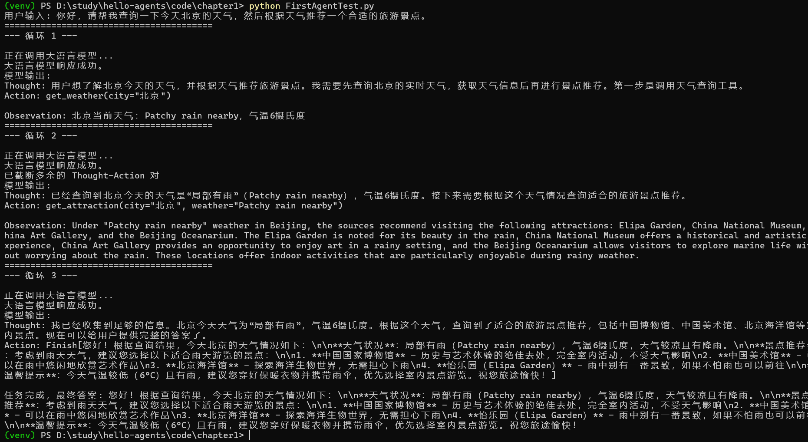

# Task01 第一章 初识智能体

## 一、核心概念
# Task01 第一章 初识智能体 学习笔记

> 学习时间：2026-11-17
> 依据：《Hello-Agents》第一章 1.1–1.5（本地：`docs/chapter1/第一章 初识智能体.md`）

---

## 一句话总结

> 智能体 = 一个能自己决定「下一步做什么」的系统。它靠感知拿到信息，靠推理决定动作，靠工具改变环境，再拿结果重新思考。
>
> 关键词是**自主性（Autonomy）**——不是执行预设指令，而是自己判断该做什么。

---

## 一、智能体的定义与四要素（1.1）

书里的原始定义：**通过传感器感知环境，自主地通过执行器采取行动，以达成特定目标的实体。**

| 要素                 | 含义                    | 智能旅行助手的例子                       |
| -------------------- | ----------------------- | ---------------------------------------- |
| **环境** Environment | 智能体所处的外部世界    | 航班 API、天气数据、用户偏好             |
| **传感器** Sensors   | 感知环境的手段          | API 返回的数据、用户输入                 |
| **执行器** Actuators | 改变环境的手段          | 调用查询接口、生成推荐                   |
| **自主性** Autonomy  | 独立决策的能力 ← 最核心 | 没人告诉它「雨天要推室内」，它自己推出来 |

「感知 → 行动」的闭环，是所有智能体行为的基础。

---

## 二、传统智能体的五级演进（1.1.1）

| 阶段                       | 核心机制                     | 它回答的问题             | 典型例子                             |
| -------------------------- | ---------------------------- | ------------------------ | ------------------------------------ |
| **简单反射** Simple Reflex | 条件-动作规则，无记忆        | 当前感知够不够决策？     | 恒温器、安全气囊                     |
| **基于模型** Model-Based   | 加了**世界模型**（内部状态） | 世界现在是什么样？       | 隧道里的自动驾驶（看不见也记得前车） |
| **基于目标** Goal-Based    | 加**规划**（搜索算法）       | 我该做什么才能达成目标？ | GPS 导航（A* 算法）                  |
| **基于效用** Utility-Based | 加**效用函数**（满意度打分） | 哪种行为最让我满意？     | 多目标权衡（最快+最省油+不堵）       |
| **学习型** Learning        | 性能元件 + 学习元件          | 不靠预设能否自己学？     | AlphaGo Zero、强化学习               |

**记忆技巧**：每一级都在回答上一级答不了的问题。

- 反射答不了「当前信息不够怎么办」→ 加内部模型
- 模型答不了「我该往哪走」→ 加目标
- 目标答不了「多个目标冲突怎么办」→ 加效用
- 全部答不了「能不能自己变强」→ 加学习

---

## 三、LLM 带来的真正变化（1.1.2）

不是「更聪明的规则」，而是**换掉了引擎**。

| 维度     | 传统智能体                 | LLM 智能体                           |
| -------- | -------------------------- | ------------------------------------ |
| 能力来源 | 工程师**显式编程**、写规则 | 海量数据**预训练**，隐式获得世界模型 |
| 行为边界 | 确定、有边界               | 灵活、通用、有**涌现能力**           |
| 输入形式 | 结构化参数                 | **自然语言**（高层、模糊、带上下文） |

LLM 智能体的三个关键能力（以「规划一次厦门之旅」为例）：

1. **规划与推理**——把高层目标拆成子任务：`[确认偏好] → [查目的地] → [订草案] → [订票]`
2. **工具使用**——发现信息缺口就主动调 API；拿到「预报有雨」后**改变后续策略**，倾向室内活动
3. **动态修正**——把用户反馈（「这家酒店超预算」）当作**新约束**，重新搜索推荐

> 核心转变：从「编写代码实现专用工具」到「引导一个通用的『大脑』去规划、行动和学习」。

---

## 四、三种分类维度（1.1.3）

**同一个智能体可以用三个不同维度描述，不要混在一起。**

| 维度           | 分几类                                                    | 分类依据                 |
| -------------- | --------------------------------------------------------- | ------------------------ |
| ① 内部决策架构 | 反应式 / 模型式 / 目标式 / 效用式（+ 学习作为**元能力**） | 决策逻辑的复杂度         |
| ② 时间与反应性 | 反应式 / 规划式 / 混合式                                  | 立即动手，还是想清楚再动 |
| ③ 知识表示     | 亚符号 / 符号 / 神经符号                                  | 知识以什么形式存在       |

### 维度②：速度与远见的权衡

| 类型                    | 优势                 | 代价                               | 场景                         |
| ----------------------- | -------------------- | ---------------------------------- | ---------------------------- |
| **反应式** Reactive     | 速度极快、计算开销低 | **短视**，易陷局部最优             | 安全气囊（毫秒级）、高频交易 |
| **规划式** Deliberative | 战略性、有远见       | 时间与算力成本高，**时机可能错过** | 商业计划、长途旅行规划       |
| **混合式** Hybrid       | 兼顾两者             | 架构复杂                           | ← **LLM Agent 就是这种**     |

LLM 智能体的混合方式很巧妙：把宏大任务拆成一串「规划-反应」的**微循环**。

- **规划（Reasoning）**发生在「思考」阶段，这是审慎的
- **反应（Acting & Observing）**发生在「行动/观察」阶段，这是即时的

> 所以 `Thought → Action → Observation` 这个循环，本质是一个「审议 + 反应」的混合体。

### 维度③：三种知识表示

|              | 亚符号（连接主义）               | 符号主义                     | 神经符号   |
| ------------ | -------------------------------- | ---------------------------- | ---------- |
| 比喻         | 牙牙学语的孩童                   | 一丝不苟的图书管理员         | 两者协作   |
| 知识形式     | 神经网络里的**统计模式**         | 明确的**规则库 / 知识图谱**  | 都有       |
| 强项         | 模式识别、抗噪声、处理图像语音   | **透明可解释**、逻辑严密     | 兼得       |
| 致命伤       | **黑箱**、会**幻觉**、逻辑推理弱 | **脆弱**、「知识获取瓶颈」   | —          |
| 卡尼曼双系统 | **系统 1**（快、直觉、并行）     | **系统 2**（慢、条理、逻辑） | 双系统协同 |

**为什么 LLM Agent 是神经符号主义的极佳范例**：内核是巨大的神经网络（模式识别 + 语言生成），但工作时会生成**结构化的中间步骤**——`Thought:`、`Action: get_weather("北京")`——这些都是明确的、可操作的**符号**。

> 一句话：**用神经网络「想」，用符号「做」。**

---

## 五、PEAS 与环境五特性（1.2.1）

PEAS = 规约任务环境的四个格子。

| 字母              | 含义                     | 智能旅行助手                 |
| ----------------- | ------------------------ | ---------------------------- |
| **P** Performance | 性能度量（怎么算干得好） | 推荐准确、响应快、用户满意   |
| **E** Environment | 环境                     | 航班 / 天气 / 酒店 API、用户 |
| **A** Actuators   | 执行器                   | 调用 API、输出推荐           |
| **S** Sensors     | 传感器                   | 用户输入、API 返回           |

环境的五个特性，以及对设计的影响：

| 特性           | 含义                           | 对智能体设计的要求         |
| -------------- | ------------------------------ | -------------------------- |
| **部分可观察** | 一次看不全                     | 需要**记忆** + **探索**    |
| **随机性**     | 结果不确定（两次查价可能不同） | 需要处理不确定性、监控变化 |
| **多智能体**   | 环境里有别的行动者             | 需要快速响应、策略选择     |
| **序贯**       | 当前动作影响未来               | 不能只看眼前一步           |
| **动态**       | 你不行动时环境也在变           | 循环必须快速、灵活         |

---

## 六、Agent Loop：整章的心脏（1.2.2）

```
感知 Perception  ← 接收观察（用户指令 / 上一步的反馈）
    ↓
思考 Thought     ← ① 规划 Planning：更新理解、拆解子任务
                 ← ② 工具选择 Tool Selection：选工具 + 定参数
    ↓
行动 Action      ← 通过执行器调工具，改变环境状态
    ↓
观察 Observation ← 环境返回结果，被传感器捕获
    ↓
（回到感知，进入下一轮）
```

三个必须理解的要点：

1. **不是一次性完成任务**，而是持续循环
2. **思考阶段包含两个子环节**：规划 + 工具选择（很多人只记住「思考」）
3. **工程上必须设最大轮次上限**，否则可能死循环

---

## 七、交互协议：Thought / Action / Observation（1.2.3）

智能体的输出**不是单一的自然语言回复**，而是一段**结构化文本**。

```text
Thought: 用户想知道北京的天气。我需要调用天气查询工具。
Action: get_weather("北京")
```

```text
Observation: 北京当前天气为晴，气温25摄氏度，微风。
```

| 组件                 | 谁负责                   | 作用                                                 |
| -------------------- | ------------------------ | ---------------------------------------------------- |
| `Thought`            | LLM 生成                 | 内部决策的「快照」，可审计                           |
| `Action`             | LLM 生成                 | 对外部世界的**指令**                                 |
| **Parser（解析器）** | **开发者代码**           | 捕获 `Action`，调用对应函数                          |
| `Observation`        | **传感器（开发者代码）** | 把 JSON 等**原始数据**翻译成简洁自然语言，再喂回 LLM |

**一个容易忽略的设计洞察**：为什么要把 JSON 转成自然语言？因为原始机器数据**有冗余**，且**不符合 LLM 的阅读习惯**。这一步「翻译」是感知系统的核心职责，不是可有可无的格式化。

---

## 八、Workflow vs Agent（1.4.3）

|          | **Workflow（工作流）**                          | **Agent（智能体）**                        |
| -------- | ----------------------------------------------- | ------------------------------------------ |
| 本质     | **预先定义、结构化编排**的流程图                | **目标导向、具备自主性**的系统             |
| 谁做决策 | 工程师写死的 if-else                            | LLM 实时推理                               |
| 例子     | 费用报销审批（<500 部门经理 / >500 加财务总监） | 旅行助手（没写「雨天推室内」，自己推出来） |
| 适合     | 流程稳定、边界清晰                              | 开放、模糊、需要临场判断                   |

书里的原话：

> **Workflow 是让 AI 按部就班地执行指令，Agent 则是赋予 AI 自由度去自主达成目标。**

**判断标准**：把那条 `if 天气=晴天 then 推荐颐和园` 的规则删掉，系统还能工作吗？

- 能 → Agent
- 不能 → Workflow

---

## 九、动手实践：跑通 1.3 的第一个智能体

### 运行命令

```powershell
cd D:\study\hello-agents
.\venv\Scripts\Activate.ps1
cd code\chapter1
python FirstAgentTest.py
```

### 实际输出




从输出可以看到完整的 Agent Loop：

- **循环 1**：`Thought` 判断要先查天气 → `Action: get_weather(city="北京")` → `Observation` 拿到北京天气
- **循环 2**：`Thought` 根据天气情况调整策略 → `Action: get_attraction(...)` → `Observation` 拿到景点推荐
- **循环 3**：`Thought` 认为信息足够 → `Action: Finish[...]` 收敛输出

### 概念与代码的对应

| 图中的阶段 | 书里的概念               | 代码位置                                                 |
| ---------- | ------------------------ | -------------------------------------------------------- |
| 感知       | 接收用户指令 / 上轮反馈  | 主循环 `for i in range(5)`，把 `prompt_history` 交给模型 |
| 思考       | 规划 Planning + 工具选择 | 系统提示词约束模型必须输出 `Thought/Action`              |
| 行动       | 调用工具改变环境         | 解析 `Action:` 后执行对应函数                            |
| 观察       | 结果转成简洁自然语言     | `Observation` 被 append 回 `prompt_history`              |

---

## 十、踩坑记录

### 坑 1：多行 Finish 导致正则匹配失败

**现象**：

```text
AttributeError: 'NoneType' object has no attribute 'group'
```

**原因**：`re.match(r"Finish\[(.*)\]", action_str)` 里的 `.` **默认不匹配换行符**。当模型给出的 `Finish[...]` 内容跨越多行时，匹配在第一个换行处就断了，返回 `None`，随后对 `None` 调 `.group()` 就崩了。

**修复**：加 `re.DOTALL`，让 `.` 也能跨行。

```python
final_answer = re.match(r"Finish\[(.*)\]", action_str, re.DOTALL).group(1)
```

**更深一层的教训**：这行代码还有第二个隐患——**没有对匹配结果做空判断**。真实项目里应该这样写：

```python
m = re.match(r"Finish\[(.*)\]", action_str, re.S)
if not m:
    print("警告：Finish 格式解析失败，原始输出：", action_str)
    break
final_answer = m.group(1)
```

> Agent 项目里，绝大多数崩溃都出在「模型没按你以为的格式输出」上。**永远不要假设 LLM 会守格式。**

### 坑 2：免费 API 的额度陷阱

AIHubmix 的免费模型有**账号级 10 次调用上限**（不是无限使用），报错：

```text
accounts that have not been recharged can only try 10 times
```

**教训**：「免费」有四种常见模式——账号级总次数、每日次数、赠送金额、限速不限量。选服务前先看清是哪一种。

**顺带的收获**：因为代码用的是 `os.getenv()` 读环境变量，换供应商只需要改 `.env` 三行，**代码一行都不用动**。这就是配置与代码分离的价值。

---

## 十一、习题

### 第 1 题：判断是否为智能体

（待补充）

### 第 2 题：健身教练的 PEAS

（待补充）

### 第 3 题：Workflow 与 Agent 的取舍

（待补充）

### 第 6 题：幻觉、死循环与评估

（待补充）

---

## 十二、我的疑问

1. 多智能体协作时，`Observation` 在多个 Agent 之间如何共享和隔离？
2. 如果模型一直不输出 `Finish`，除了设最大轮次，还有哪些工程上的收敛策略？

---

## 参考

- 《Hello-Agents》第一章（本地：`docs/chapter1/第一章 初识智能体.md`）
- 书稿 PDF（图文完整）：`docs/Hello-Agents-V1.0.3-20260717.pdf`
- 代码：`code/chapter1/FirstAgentTest.py`

## 二、动手实践

跑通 1.3 的 ReAct 循环，完整输出如下：


## 三、踩坑记录
To prevent abuse of free resources, accounts that have not been recharged can only try 10 times.

